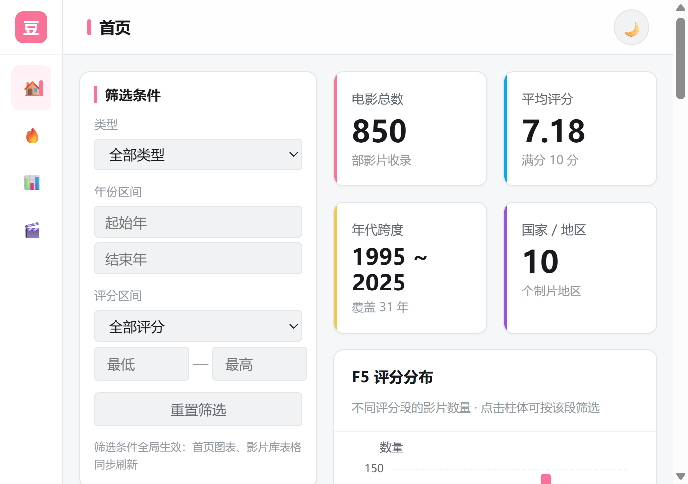

# 豆瓣电影数据洞察看板

> 面向普通电影观众的数据看板 —— Web 开发技术课程小组作业
>
> 项目定位（课程要求）：**帮助用户发现优质作品、了解评分分布与类型趋势**
>
> 界面形态：参考哔哩哔哩网页版 —— **左侧多级菜单 + 右侧内容按页面切换**（不做长页滚动），
> 排行榜参考豆瓣/B 站影视榜单（封面 + 排名 + 导演主演 + 梗概），普通观众也能轻松读。
> 技术栈：Spring Boot + MySQL + 原生前端 + ECharts，实现课程要求的 F1-F9 前端功能与 A1-A5 后端接口。

---

## 📸 运行截图

> 📌 **截图位置**：请在答辩/提交前将实际运行截图保存到 `docs/screenshots/` 目录，并替换下方占位。

| 序号 | 截图内容 | 占位文件 |
|------|---------|---------|
| 1 | 首页（KPI + 评分分布 + 年度趋势 + 热榜速览） | `docs/screenshots/01-home.png` |
| 2 | 综合热榜（豆瓣式排行榜卡片：封面/主演/梗概） | `docs/screenshots/02-rank-overall.png` |
| 3 | 分地区 / 分年代 / 分类型榜单 | `docs/screenshots/03-rank-dimension.png` |
| 4 | 类型对比雷达图 | `docs/screenshots/04-radar.png` |
| 5 | 作品详情弹窗（封面 + 同档期对比小图） | `docs/screenshots/05-detail.png` |
| 6 | 影片库表格（每页 10 条） | `docs/screenshots/06-library.png` |
| 7 | 明暗主题切换效果 | `docs/screenshots/07-theme.png` |
| 8 | Swagger UI 接口文档（<http://localhost:8081/swagger-ui.html>） | `docs/screenshots/08-swagger.png` |
| 9 | MySQL Workbench 数据量验证（`SELECT COUNT(*) FROM movies` = 850） | `docs/screenshots/09-mysql.png` |



---

## 🎯 项目背景与功能

### 背景

电影投资决策长期依赖经验判断，缺少直观的数据支撑。本项目以公开电影数据为基础，围绕「地域文化」「类型×档期」「投入产出」「人才图谱」「评分画像」五个维度，构建面向电影产业链的数据洞察看板。

### 页面结构（左侧多级菜单，点击切换，共 8 个页面）

| 菜单 | 页面 | 内容 |
|------|------|------|
| 🏠 首页 | 首页 | 4 个 KPI 卡片 + F5 评分分布直方图 + F6 年度趋势 + F7 综合热榜速览（TOP 5） |
| 🔥 热度排行 ▸ | 综合热榜 | F7 完整榜单 TOP 20，一键切换「按评分 / 按评价人数」 |
| | 分地区 | 11 个地区 chips 筛选，查看该地区口碑最佳影片 |
| | 分年代 | 1995-1999 / 2000-2004 / … / 2020-2025 六个年代档 |
| | 分类型 | 14 种类型 chips 筛选 |
| 📊 数据洞察 ▸ | 类型对比 | F8 柱状图 / 雷达图双视图（数量、评分、票房三维度） |
| | 深度分析 | 成本-票房散点、地区×类型热力、档期分析、导演 TOP N（滚动懒渲染） |
| 🎬 影片库 | 影片库 | F9 全局筛选（类型/年份/评分/关键词）+ 表格/卡片双视图 + 每页 10 条 |

> 影片库的筛选条件是**全局**的：同时作用于 F9 表格与全站图表（课程里程碑"图表随筛选刷新"）。

### 课程要求功能对照（F1-F9）

| 编号 | 功能 | 实现 |
|------|------|------|
| F1 | 看板首页 | 左侧多级菜单 + 右侧内容区，按页面切换，无需长页滚动 |
| F2 | 类型筛选 | 类型下拉框（14 种，来自 `GET /api/types`） |
| F3 | 年份区间筛选 | 起止年份输入，全站图表与表格联动 |
| F4 | 评分筛选 | 自定义评分区间（配合影片库筛选条） |
| F5 | 评分分布直方图 | 0.5 分粒度 16 个评分段，峰值段高亮，点击柱体按该段筛选 |
| F6 | 年度趋势折线图 | 平均评分折线为主视觉 + 影片数量柱状背景 |
| F7 | 热门 TOP10 | **豆瓣式排行榜卡片**：封面、排名、标题、年份、导演、主演、梗概；综合/分地区/分年代/分类型四个维度，按评分/按评价人数两种口径 |
| F8 | 类型对比 | 柱状图 / 雷达图一键切换 |
| F9 | 作品详情表格 | 表格/卡片双视图，每页 10 条，点击行看详情（含同档期对比迷你图） |
| 体验 | — | 明暗主题、封面渐变由标题哈希生成（离线可用）、空数据友好占位、请求取消与去重 |

---

## 🛠 技术栈

| 分层 | 技术选型 | 选型理由 |
|------|---------|---------|
| 后端 | Java 17 · Spring Boot 3.2.5 · Spring Data JPA · MySQL Connector/J 8.3 · OpenCSV | 分层架构清晰、JPA 自动生成查询、内置连接池与 CORS；OpenCSV 用于启动时加载初始数据 |
| 数据库 | MySQL 8.0 | 真实持久化关系库，支持复杂 JOIN 与索引优化，可现场演示数据真实性 |
| 前端 | 原生 HTML5 + CSS3 + ES6 JavaScript（**无 Vue/React/axios/构建工具**） | 课程硬性要求；用 IIFE 模块化 + CSS 变量保证工程质量；界面参考哔哩哔哩网页版（左侧多级菜单 + 卡片式内容） |
| 图表 | Apache ECharts 5.5.0（**本地 vendor 化** + 多 CDN 兜底） | 中文文档完善，支持双轴、热力、散点、桑基等全部所需图表；本地化后断网/被墙也能正常渲染 |
| HTTP 调用 | 原生 Fetch API（自封装 `api.js`） | 统一超时 8s、缓存、错误校验，替代 axios |
| 部署 | Nginx 1.26.2（Windows） | 静态托管 + `/api/` 反向代理（同源无跨域）+ 静态资源缓存 |
| 接口管理 | SpringDoc（Swagger UI，OpenAPI 自动生成）+ ApiFox（导入 `docs/apifox-import.json`） | 课程要求「API 文档自动生成」；ApiFox 便于团队协作联调 |
| 数据处理 | Python 3 | 数据集清洗转换（`scripts/build_dataset.py`，规则可复现） |

---

## 📁 目录结构

```
movie-dashboard/
├── README.md                          # 本文件（项目主文档）
├── .gitignore                         # 忽略规则：编译产物/IDE/本机凭据/二进制
├── .env.example                       # 环境变量示例（复制为 .env 后填写，不入库）
├── backend/                           # 【后端】Spring Boot 工程
│   ├── pom.xml                        # Maven 依赖清单
│   ├── mvnw / mvnw.cmd                # Maven Wrapper（无需全局安装 Maven）
│   └── src/main/
│       ├── java/com/movie/dashboard/
│       │   ├── MovieDashboardApplication.java      # 启动类
│       │   ├── config/                             # 配置层
│       │   │   ├── CorsConfig.java                 # 跨域配置（Nginx 代理之外的兜底）
│       │   │   ├── DataInitializer.java            # 启动自检 + 从 CSV 加载初始数据
│       │   │   └── OpenApiConfig.java              # SpringDoc/Swagger UI 配置
│       │   ├── controller/                         # REST 接口层
│       │   │   ├── WorksController.java            # /api/works 系列（课程要求 A2-A5）
│       │   │   ├── TypesController.java            # /api/types（课程要求 A1）
│       │   │   ├── MovieController.java            # /api/movies 系列（保留兼容）
│       │   │   └── StatsController.java            # /api/stats/* 系列（含 overview 聚合）
│       │   ├── service/                            # 业务逻辑层
│       │   │   ├── MovieService.java               # 分页查询 / 详情 / 筛选器选项
│       │   │   └── StatsService.java               # 图表聚合 + 评分分布 + 热门 TOP + 筛选过滤
│       │   ├── repository/                         # 数据访问层（JPA）
│       │   │   ├── MovieRepository.java            # 多条件筛选 JPQL + 分页
│       │   │   ├── GenreRepository.java
│       │   │   └── MovieFinancialRepository.java
│       │   ├── entity/                             # 数据库实体（映射 4 张表）
│       │   │   ├── Movie.java  Genre.java  MovieFinancial.java
│       │   ├── dto/                                # 请求/响应数据传输对象（13 个）
│       │   │   └── …StatsOverviewDTO / WorksStatsDTO / RatingDistributionDTO 等
│       │   └── exception/                          # 统一响应 + 全局异常处理
│       │       ├── Result.java                     # {code, message, data}
│       │       └── GlobalExceptionHandler.java     # @ControllerAdvice
│       └── resources/
│           ├── application.yml                     # 主配置（环境变量占位，无真实凭据）
│           ├── application-local.yml.example       # 本地配置模板 → 复制为 application-local.yml
│           ├── schema.sql                          # 建表 DDL（4 张表）
│           └── data/movies.csv                     # 2050 条真实豆瓣数据（启动时自动导入 MySQL）
├── frontend/
│   ├── dist/                     # 【前端】Nginx 部署根目录
│   │   ├── index.html             # 单页应用入口
│   │   ├── css/style.css          # 明暗主题 + CSS Grid 布局
│   │   ├── vendor/echarts.min.js  # ECharts 5.5.0 本地副本（离线可用，不受 CDN 屏蔽影响）
│   │   └── js/                    # 19 个 JS 文件：config + theme + chart-config + loader + main + ranking + works-table + utils(3) + charts(8)
│   │       ├── config.js          # 全局配置（API_BASE 为空串，走 Nginx 同源代理）
│   │       ├── theme.js           # 设计令牌：CSS 变量 + ECharts 主题（app-light / app-dark）同源，B 站粉色板
│   │       ├── chart-config.js    # 图表声明表：新增图表只加一行（含所属页面 page 字段）
│   │       ├── echarts-loader.js  # ECharts 加载器：本地优先，失败自动回退多个 CDN
│   │       ├── main.js            # 主入口：菜单路由 + 各页面数据加载 + 筛选状态
│   │       ├── ranking.js         # 豆瓣式排行榜卡片（封面/排名/导演/主演/梗概）
│   │       ├── works-table.js     # F9 作品表格/卡片渲染（每页 10 条）
│   │       ├── utils/             # api.js(fetch封装+去重+取消) / debounce.js / ui.js
│   │       └── charts/            # registry.js(注册中心，按页面渲染) + 7 个 ECharts 图表模块
│   └── nginx-1.26.2/              # 组长本机的 Nginx（二进制，.gitignore 排除；组员需自行下载）
├── scripts/                       # 数据脚本（Python）与前端自测脚本
│   ├── build_dataset.py           # 真实豆瓣数据集清洗转换（Kaggle CSV → movies.csv）
│   ├── convert_to_normalized.py   # CSV → 规范化 SQL（H2 时代产物，保留备查）
│   ├── init_h2_sql.py             # 同上（H2 时代遗留，待清理）
│   ├── frontend-smoke-test.js     # 前端冒烟测试：node scripts/frontend-smoke-test.js
│   ├── requirements.txt           # Python 依赖清单
│   └── movies.csv                 # 生成的数据副本（与后端 classpath 内 CSV 同源）
├── CONTRIBUTING.md                # 贡献指南入口（PR/Issue 时 GitHub 自动提示）
└── docs/                          # 文档（入口：docs/README.md 索引）
    ├── README.md                  # 文档地图 + 三条阅读路线
    ├── 团队协作指南.md             # GitHub 协作全流程：分支保护 / PR / Issue / 规范
    ├── 快速上手.md                 # 从零到跑起来（环境/配置/启动/FAQ/版本演进）
    ├── 代码说明.md                 # 模块职责 / 核心流程 / 数据模型 / 扩展指引
    ├── 数据库与API契约.md          # 表结构 + 接口契约 + JSON 示例
    ├── 项目逻辑流程.md             # 开发路线图 + 时序图 + 扩展点
    ├── 组员任务清单.md             # 三人分工明细与进度
    ├── 答辩预案.md                 # 开场白 + 演示流程 + 高频问答
    ├── 数据说明.md                 # 数据分布与生成规则
    ├── AI使用记录表.md             # AI 辅助占比如实记录（课程要求）
    ├── apifox-import.json         # ApiFox 导入文件（OpenAPI 3.0，15 个接口，由 /v3/api-docs 导出）
    ├── mysql-init.sql             # MySQL 建库脚本
    └── nginx.conf.example         # Nginx 配置模板（路径占位符，组员复制后改 root）
```

---

## ✅ 环境要求

| 软件 | 版本要求 | 用途 | 备注 |
|------|---------|------|------|
| JDK | 17 及以上 | 后端编译运行 | 编译产物为 Java 17 字节码 |
| MySQL Server | 8.0.x | 数据存储 | 需记住自己设置的账号密码 |
| MySQL Workbench | 8.0.x | 数据库 GUI 管理 | 选装，用于验证数据 |
| Nginx | 1.24+（Windows 解压版） | 前端托管 + API 代理 | ⚠️ 二进制不入库，组员 clone 后需自行下载（见 `docs/快速上手.md`） |
| IntelliJ IDEA | 2023+ | 后端开发调试 | 选装，也可命令行 Maven |
| ApiFox | 最新版 | 接口调试 | 选装 |
| Python | 3.8+ | 数据脚本（可选） | 仅需重新生成数据时使用 |
| Git | 2.x | 版本控制 | |

---

## 🚀 安装与启动

启动顺序固定为：**MySQL → 后端 → Nginx**，三者缺一不可。

### Step 0 · 准备数据库（仅首次）

```sql
-- MySQL Workbench 打开 docs/mysql-init.sql 执行，或直接执行：
CREATE DATABASE IF NOT EXISTS movie_dashboard
  DEFAULT CHARACTER SET utf8mb4 COLLATE utf8mb4_unicode_ci;
```

### Step 1 · 配置数据库连接（仅首次）

二选一：

```bash
# 方式 A（推荐）：复制模板，填写自己的账号密码
cd backend/src/main/resources
cp application-local.yml.example application-local.yml     # Windows: copy
# 编辑 application-local.yml 里的 password

# 方式 B：设置环境变量（优先级最高）
export DB_USERNAME=root
export DB_PASSWORD=你的密码
export DB_HOST=localhost DB_PORT=3306 DB_NAME=movie_dashboard SERVER_PORT=8081
# Windows PowerShell：$env:DB_PASSWORD="你的密码"
```

> ⚠️ `application-local.yml` 与 `.env` 已在 `.gitignore` 中排除，**不会进入版本库**。
> 全部可配变量见 `.env.example`。

### Step 2 · 启动后端

```bash
cd backend
mvnw.cmd spring-boot:run          # Windows
./mvnw spring-boot:run            # macOS / Linux
# 或 IDEA：打开 MovieDashboardApplication.java → 右键 Run
```

首次启动会依次完成：Hibernate 自动建表 → DataInitializer 从 `movies.csv` 把 2050 条真实豆瓣数据写入 MySQL → 监听 **8081** 端口。

成功标志（控制台）：

```
Started MovieDashboardApplication in x seconds
  API 基地址 : http://localhost:8081/api
  [DataInit] 加载完成！ 电影总数: 850  类型: 14  财务记录: 850
```

> 后续重启若表中已有数据则跳过加载。想重新加载：先执行
> ```sql
> SET FOREIGN_KEY_CHECKS=0;
> TRUNCATE TABLE movie_genres; TRUNCATE TABLE genres; TRUNCATE TABLE movies;
> SET FOREIGN_KEY_CHECKS=1;
> ``` 再重启（自动重新导入 2050 条真实数据）。

### Step 3 · 配置并启动 Nginx

> ⚠️ `frontend/nginx-1.26.2/` 被 .gitignore 排除（二进制不入库），**clone 仓库的同学需自行到 nginx.org 下载**，解压到无中文/无空格路径。

```bash
# 用仓库模板生成配置：复制 docs/nginx.conf.example 覆盖 <你的nginx>/conf/nginx.conf
# 把 root 一行的 __YOUR_FRONTEND_DIST_PATH__ 改成本项目 frontend/dist 的绝对路径（正斜杠）
# listen 当前为 8083（80 被占用时的团队约定）；若改回 80，访问地址变成 http://localhost/
```

```powershell
cd frontend/nginx-1.26.2
.\nginx.exe              # 启动
.\nginx.exe -s reload    # 改配置后重载
.\nginx.exe -s stop      # 停止
```

### Step 4 · 打开看板

浏览器访问 **http://localhost:8083/**（Ctrl+Shift+R 强刷避免旧缓存）。

### Step 5 · ApiFox 调试接口（可选）

ApiFox → 新建项目 → 导入 → OpenAPI/Swagger → 选 `docs/apifox-import.json` → 新建环境，`baseURL` 填 `http://localhost:8083`（走 Nginx）或 `http://localhost:8081`（直连后端）。

---

## ⚡ 性能与体验优化（2026-10 改造）

| 优化点 | 做法 | 实测效果 |
|--------|------|---------|
| **图表库离线可用** | ECharts 5.5.0 本地化到 `frontend/dist/vendor/`，加载失败自动回退 4 个 CDN 镜像 | 断网/被墙也能渲染，不再整屏"加载中..." |
| **1 次请求出整屏** | 新增 `/api/stats/overview`：后端只查一次 movies + 一次 financials，6 类图表在内存里基于同一份数据算出 | 整屏数据请求 **2725ms → 600ms**（约 4.5 倍） |
| **响应压缩** | 后端开启 gzip（`server.compression`），Nginx 模板同时对静态资源开 gzip | overview 响应 **71KB → 14KB**（-80%） |
| **Tab 懒渲染** | Tab 面板内 4 张图改为"切到才画" | 首屏少绘 4 张图，主线程更早可交互 |
| **请求去重 + 取消陈旧响应** | `api.js` 记录进行中的请求；连续筛选时 abort 上一轮，避免旧数据覆盖新数据 | 快速调整筛选不再出现数据"闪回" |
| **主题切换零请求** | 切换明暗主题只重绘图表，复用内存中的数据 | 主题切换不再触发 6 个接口 |
| **列表渲染优化** | DocumentFragment 批量插入 + 事件委托 + HTML 转义 | 减少重排，标题含特殊字符也不会破坏结构 |
| **UI 调优单一入口** | 页面 CSS 变量与 ECharts 主题同源于 `js/theme.js` | 改配色只动 1 个文件，全部图表零改动 |
| **滚动懒渲染** | 深度分析区 4 张图用 IntersectionObserver 进入视口才绘制 | 首屏只画 4 张核心图，主线程更早可交互 |

> 前端自测：`node scripts/frontend-smoke-test.js`（无浏览器也能验证 10 张图表的 option 构建、懒渲染调度与主题切换）。

---

## 📡 接口说明

统一前缀 `/api`，统一响应格式 `{"code":0,"message":"ok","data":...}`（`code=0` 表示成功）。

### 课程要求接口（A1-A5）

| # | Method | 路径 | 说明 | 主要参数 |
|---|--------|------|------|---------|
| A1 | GET | `/api/types` | 返回类型列表（14 种） | — |
| A2 | GET | `/api/works` | 按类型、年份区间、评分区间查询，**分页返回** | `page`(0起) `size`(默认20) `type` `yearStart` `yearEnd` `ratingMin` `ratingMax` `title` |
| A3 | GET | `/api/works/{id}` | 单条作品详情（含类型、财务） | 路径 id |
| A4 | GET | `/api/works/stats` | 统计：**评分分布 + 年度趋势 + 类型对比** | 同 A2 筛选参数 |
| A5 | GET | `/api/works/top` | TOP10（按评分或评价人数） | `n`(默认10) `by`(`rating`/`votes`) + 筛选参数 |

### 拓展接口（看板深度分析用）

| # | Method | 路径 | 说明 | 主要参数 |
|---|--------|------|------|---------|
| E1 | GET | `/api/stats/overview` | **看板聚合接口**：一次返回 KPI + 全部图表数据 | 全部筛选参数 + `n` |
| E2 | GET | `/api/stats/scatter-cost-box` | 成本-票房散点 | 筛选参数 |
| E3 | GET | `/api/stats/heatmap` | 国家 × 类型评分热力矩阵 | 筛选参数 |
| E4 | GET | `/api/stats/season-analysis` | 档期 × 类型交叉分析 | 筛选参数 |
| E5 | GET | `/api/stats/top-directors` | 导演作品 TOP N | `n` + 筛选参数 |
| E6 | GET | `/api/movies` · `/api/movies/{id}` · `/api/movies/filters` | 早期版本接口，保留兼容 | — |

响应示例（A2）：

```json
{
  "code": 0,
  "message": "ok",
  "data": {
    "content": [{"id": 3080, "title": "冷酷的谎言往事", "director": "Satyajit Ray", "rating": 9.8, "voteCount": 38616, "year": 2016, "genres": ["动画","Cult","文艺"]}],
    "totalElements": 850,
    "totalPages": 71
  }
}
```

> 分页字段遵循课程要求统一格式：`page` / `size` / `total` / `records`，`page` **从 0 开始**
> （前端页码从 1 起，由 `main.js` 做换算）。
> 完整契约与更多示例见 [`docs/数据库与API契约.md`](docs/数据库与API契约.md)；
> 在线调试用 **Swagger UI**：<http://localhost:8081/swagger-ui.html>（或用 ApiFox 导入 `docs/apifox-import.json`）。

---

## 📊 数据来源与数据模型

### 数据来源（真实数据，可溯源）

| 项 | 说明 |
|----|------|
| 数据集 | [Kaggle: Douban Movies Dataset](https://www.kaggle.com/datasets/dengfuping/douban-movies-dataset)（**CC0 公有领域**） |
| 镜像仓库 | [github.com/dengfuping/douban-movies-spider](https://github.com/dengfuping/douban-movies-spider) |
| 合规性 | 使用公开数据集，**不写爬虫访问豆瓣**，规避 robots 协议风险 |
| 真实性 | 全部为豆瓣真实电影（肖申克的救赎 9.7/322万人、霸王别姬 9.6/238万人…），主键 = 豆瓣 subject id，可溯源 |
| 转换脚本 | `python3 scripts/build_dataset.py`（清洗 + 规则映射，规则见 `docs/数据说明.md`） |
| 入库方式 | CSV → DataInitializer 经 JPA 写入 MySQL（**非前端静态文件直读**） |
| 海报 | 数据库存豆瓣真实 poster_url；因豆瓣 CDN 防盗链（校验 Referer），前端经后端代理 `/api/works/{id}/poster` 加载 |

### 数据规模（2050 条真实数据实测）

| 指标 | 数值 |
|------|------|
| 电影总数 | **2050** 条（课程要求 ≥500） |
| 年份跨度 | 1931 – 2026 |
| 类型数 | **28** 种（剧情 1100 / 动作 616 / 喜剧 597 / 爱情 429…） |
| 制片地区 | 日本 / 美国 / 中国大陆 / 中国香港 / 法国 / 韩国 等 |
| 评分分布 | 峰值 8.0–8.5 分（345 部），范围 2.7–9.7 |
| 海报 URL 覆盖率 | **100%** |
| 简介覆盖率 | 99%+ |

### 数据模型（3 张表，满足第三范式）

```
genres ──< movie_genres >── movies
```

| 表名 | 职责 | 关键字段 |
|------|------|---------|
| `movies` | 电影主表（主键=豆瓣 subject id） | id, title, director, lead_actor, country, release_year, release_date, season_tag, duration, rating, vote_count, intro, poster_url, link |
| `genres` | 类型字典表 | id, name（唯一） |
| `movie_genres` | 电影-类型多对多关联 | movie_id, genre_id（联合主键） |

> 设计要点：类型拆分 + 关联表满足 3NF；公开数据集无真实预算/票房，
> 故不设财务表、不做票房类统计（禁止编造数据）；档期由真实上映日期的月份映射。

---

## 👥 组员分工

| 成员 | 角色 | 负责模块 |
|------|------|---------|
| 张** | 组长 | 后端全链路（Spring Boot 架构、Entity/DTO/Controller/Service）+ MySQL + Nginx 部署 + 总协调 + 答辩主讲 |
| 钟** | 前端 | 页面结构（HTML/CSS）+ 8 张 ECharts 图表 + 筛选联动 + 明暗主题切换 |
| 曹** | 拓展 | Git 协作 + 数据生成脚本 + ApiFox 接口联调测试 + 文档 + 拓展图表（成本效益/地域文化） |

> 姓名已按课程提交要求脱敏（保留姓氏 + 星号）。详细分工见 `docs/组员任务清单.md`。

---

## 🤝 团队协作

仓库：<https://github.com/iridescent2333/douban-movies-data-analysis>

- **分支模型**：`main` 受保护，只接受 PR；每人从最新 main 切 `feature/*` 分支开发
- **合并要求**：至少 1 人 review 通过 + PR 检查单全过 + 意见全部解决
- **Commit 规范**：Conventional Commits（`feat:` / `fix:` / `docs:` / `refactor:` / `chore:`）
- **任务分派**：GitHub Issues + Projects 看板，做完 PR 描述写 `Closes #编号`
- **完整流程**（邀请成员、分支保护配置、审查清单、协作节奏）：见 [`docs/团队协作指南.md`](docs/团队协作指南.md)

---

## ❓ 常见问题（FAQ）

| 现象 | 原因 | 解决办法 |
|------|------|---------|
| 后端报 `Access denied for user` | 账号或密码不对 | 检查 `application-local.yml` / `.env` 中的凭据 |
| 后端报 `Unknown database 'movie_dashboard'` | 库没建 | 执行 `docs/mysql-init.sql` |
| 后端报 `Communications link failure` | MySQL 服务没启动 | Windows：`net start MySQL80`；macOS：`brew services start mysql` |
| 页面能打开但图表全空 | 后端没起来 / 前端 JS 缓存 | 先验证 `http://localhost:8081/api/movies?page=0&size=1`；再 Ctrl+Shift+R 强刷 |
| F12 里 `/api/...` 报 **502 Bad Gateway** | Nginx 转发不到后端 | 确认后端在 8081 监听，检查 nginx.conf 的 `proxy_pass` 端口 |
| 页面 404 且样式全丢 | nginx.conf 的 `root` 路径不对 | 改成本机 `frontend/dist` 绝对路径（正斜杠）后 `nginx.exe -s reload` |
| Nginx 启动失败 | 8083 端口被占用（团队约定端口，原 80 常被 IIS / 旧 nginx 占） | `netstat -ano \| findstr :8083` 查 PID → `taskkill /F /PID xxx`，或再换一个 `listen` 端口并同步本文档 |
| IDEA Run 报 `Port 8081 already in use` | 旧进程没关 | `netstat -ano \| findstr :8081` → `taskkill /F /PID xxx` |
| 改了 CSV 但数据没变 | DataInitializer 检测到表非空会跳过 | 执行 `docs/数据说明.md` 第二节的重置 SQL 后重启 |
| 筛选后数量没变化 | 前端 localStorage 缓存 5 分钟 | Ctrl+Shift+R 强刷或清缓存验证 |
| ApiFox 导入失败 | JSON 格式问题 | `python -m json.tool docs/apifox-import.json` 校验 |
| 图表全空白 + 控制台 `ERR_CONNECTION_RESET` | **旧版本**直接引 cdn.jsdelivr.net 的 ECharts，CDN 被墙导致 `window.echarts` 为空 | 现已把 ECharts 本地化到 `frontend/dist/vendor/echarts.min.js`；确认该文件存在（未被误删），并 **Ctrl+Shift+R 强刷** |
| 改了前端代码但页面没变化 | Nginx 对 js/css 设了 7 天强缓存 | Ctrl+Shift+R 强刷；或 `.\nginx.exe -s reload` |
| 调后端时提示"聚合接口不可用" | 前后端版本不匹配（后端未重启到新版） | 重启后端即可；前端会自动降级为旧的 6 接口模式，功能不受影响 |
| 组员 clone 后启动无数据 | 正常，首次启动会加载 CSV | 等控制台出现 `[DataInit] 加载完成！` |
| 组员 clone 后没有 nginx 目录 | 正常，二进制被 .gitignore 排除 | 自行下载 Nginx，按 `docs/快速上手.md` Step 3 配置 |

更多排查细节见 [`docs/快速上手.md`](docs/快速上手.md)。

---

## 📚 文档导航

完整文档地图与阅读路线见 [`docs/README.md`](docs/README.md)。常用入口：

| 文档 | 用途 |
|------|------|
| [`docs/团队协作指南.md`](docs/团队协作指南.md) | **三人协作必读**：分支模型、PR 流程、Commit 规范、审查清单 |
| [`docs/快速上手.md`](docs/快速上手.md) | 新组员/换电脑：从零安装到看板跑起来 + FAQ |
| [`docs/代码说明.md`](docs/代码说明.md) | 模块职责、核心流程、数据模型、二次开发与扩展指引 |
| [`docs/数据库与API契约.md`](docs/数据库与API契约.md) | 表结构、A1-A5 接口契约与 JSON 示例 |
| [`docs/apifox-import.json`](docs/apifox-import.json) | ApiFox 直接导入（或访问 Swagger UI） |
| [`docs/nginx.conf.example`](docs/nginx.conf.example) | Nginx 配置模板 |
| [`docs/答辩预案.md`](docs/答辩预案.md) | 演示流程与老师高频问答 |
| [`docs/AI使用记录表.md`](docs/AI使用记录表.md) | AI 使用占比如实记录 |

---

## 🔒 隐私与配置安全

- 配置文件中**不含任何真实凭据**：数据库连接通过环境变量 `${DB_USERNAME}` / `${DB_PASSWORD}` 注入
- 本地凭据载体（`application-local.yml`、`.env`）已在 `.gitignore` 中排除
- 文档中的组员姓名已脱敏为「姓氏 + 星号」

---

*Web 开发技术 · 小组作业 · 2026*
